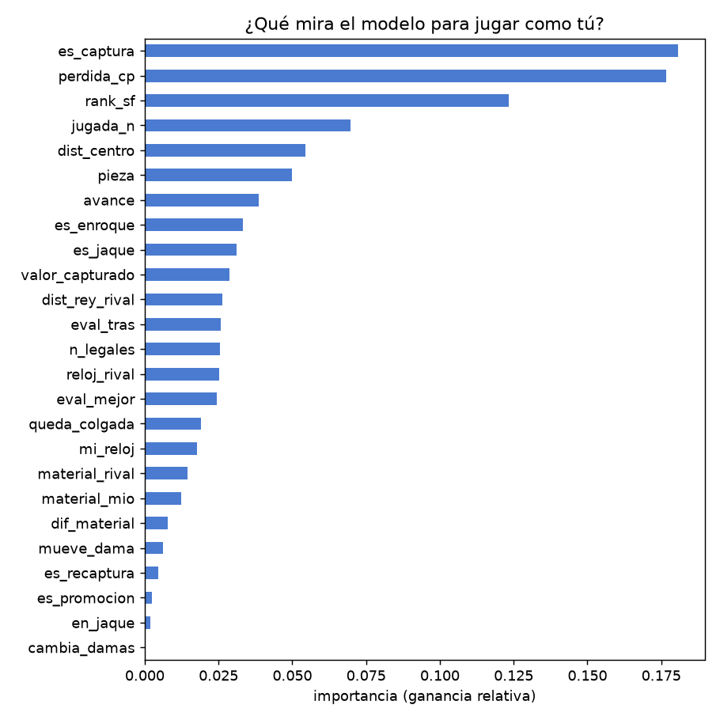

# Clon de Irvin: modelado del comportamiento individual de un jugador de ajedrez mediante búsqueda adversarial y aprendizaje de *ranking*

**Proyecto final, Inteligencia Artificial**
**Autor:** Irvin Lozano
**Fecha:** noviembre de 2026
**Repositorio:** https://github.com/irvinlozano/clon-ajedrez

---

## Resumen

Los motores de ajedrez actuales juegan muy por encima del nivel humano, pero no se comportan como humanos. Este proyecto construye un agente que **imita el estilo de juego de una persona concreta**: el autor, con unos 900 puntos Elo en partidas *rapid* de chess.com.

El sistema combina tres piezas:
1. Un **libro de aperturas** estimado a partir de las frecuencias del jugador.
2. Un **generador de candidatas** basado en búsqueda adversarial, el motor Stockfish 19.
3. Un **modelo de aprendizaje supervisado**, LightGBM con objetivo LambdaRank, que ordena las candidatas según la probabilidad de que el jugador las elija.

Se entrenó con 4,224 partidas y se evaluó con las 746 partidas más recientes, que suman 21,089 posiciones nunca vistas. En ellas el agente elige **la misma jugada que el humano en el 45.7% de los casos**. Stockfish lo hace en el 32.0% y la elección al azar entre candidatas en el 12.6%.

Además, con un muestreo *softmax* de temperatura 1.0, el agente reproduce la **magnitud de los errores** del jugador: pierde 48.8 centipeones por jugada, contra 45.7 del humano.

Por su objetivo, el proyecto se ubica en el enfoque de **actuar como humano** de Russell y Norvig. Es una versión acotada al ajedrez de la prueba de Turing.

**Palabras clave:** ajedrez, modelado de comportamiento, aprendizaje de *ranking*, LambdaRank, búsqueda alfa-beta, prueba de Turing, agentes.

---

## 1. Introducción

El ajedrez ha sido un problema de referencia en la IA desde sus inicios.
- Shannon (1950) propuso cómo programar una computadora para jugarlo.
- Turing (1950) lo mencionó como uno de los campos donde las máquinas podrían competir con el ser humano.
- Desde Deep Blue (1997) y AlphaZero (2017), el problema de **jugar bien** se considera resuelto en la práctica: Stockfish supera por cientos de puntos Elo a cualquier campeón del mundo.

Queda abierto un problema distinto y menos estudiado: **jugar como una persona**.
- Un motor "debilitado" no se parece a un humano de nivel equivalente. Comete errores al azar, mientras que el humano comete errores sistemáticos que dependen de su estilo, del tiempo disponible y del tipo de posición.
- Para un jugador, un oponente que reproduzca su propio estilo tiene usos concretos:
  - entrenar contra uno mismo;
  - identificar patrones de error;
  - preparar aperturas;
  - estudiar la pregunta de fondo: **¿se puede capturar en un modelo la "forma de pensar" de alguien a partir de lo que hace?**

**Objetivo general.** Construir un agente que, dada una posición de ajedrez, elija la jugada que el autor elegiría, tanto sus aciertos como sus errores.

**Objetivos específicos:**
1. Obtener el historial completo de partidas *rapid* del autor desde la API pública de chess.com.
2. Formular la imitación como un problema de aprendizaje supervisado y entrenar un modelo.
3. Evaluar la fidelidad del agente con una métrica objetiva (coincidencia de jugada) contra líneas base.
4. Calibrar el agente para que reproduzca la distribución de errores del humano.
5. Ofrecer una interfaz para jugar contra el agente y observar en qué basa sus decisiones.

---

## 2. Marco teórico

### 2.1 Los cuatro enfoques de la IA (Russell y Norvig)

Russell y Norvig (2021) organizan las definiciones de IA en dos ejes: **pensar contra actuar** y **fidelidad humana contra racionalidad**.

| | Humano | Racional |
|---|---|---|
| **Pensar** | Modelado cognitivo | Leyes del pensamiento (lógica) |
| **Actuar** | **Prueba de Turing** ← *este proyecto* | Agente racional (Stockfish) |

El proyecto se ubica en **actuar como humano**:
- **El criterio de éxito es la indistinguibilidad.** Que el agente se comporte como el autor, no que gane ni que juegue de forma óptima.
- **No hay pretensión de modelar procesos internos.** No modelamos cómo piensa el autor (atención, memoria, cálculo), lo que sería *pensar como humano*. Solo modelamos qué hace ante cada posición.
- **Stockfish es el contraste natural.** Es un **agente racional basado en utilidad**: elige la jugada que maximiza su función de evaluación. Nuestro agente lo usa como componente, pero lo subordina a un criterio de fidelidad humana.

Esto conecta con la propuesta original de Turing (1950):
- Turing sustituye la pregunta "¿pueden pensar las máquinas?" por un criterio externo y observable, el juego de la imitación.
- De forma análoga, en lugar de preguntar si el modelo "entiende" el ajedrez como el autor, preguntamos si **sus decisiones son indistinguibles** de las del autor.
- En la objeción de la conciencia, Turing argumenta que solo podemos juzgar a otros por su conducta. Aquí hacemos lo mismo: juzgamos al clon solo por sus jugadas.

### 2.2 El agente y su entorno (PEAS)

| Elemento | Descripción |
|---|---|
| **Medida de desempeño** | Coincidencia con la jugada real del autor, y similitud en la pérdida promedio de centipeones |
| **Entorno** | Tablero de ajedrez, oponente y reloj (10 min) |
| **Actuadores** | Ejecutar una jugada legal |
| **Sensores** | Posición actual (FEN), historial de jugadas, tiempo restante |

**Propiedades del entorno:** totalmente observable, determinista, secuencial, **multiagente competitivo**, discreto y conocido. Es semidinámico por el reloj.

El agente es **autónomo**: su conocimiento del estilo no lo programa el diseñador, sino que lo **aprende** de las partidas.

### 2.3 Búsqueda adversarial

Como el árbol de juego crece de forma exponencial con las piezas y sus movimientos, Stockfish combina **minimax con poda alfa-beta** (Knuth y Moore, 1975) con heurísticas como:
- *iterative deepening*;
- tablas de transposición;
- *move ordering* y reducciones.

Su función de evaluación, que en los motores clásicos era el conteo de material, es desde 2020 una red neuronal eficientemente actualizable, NNUE (Nasu, 2018).

En este proyecto Stockfish no decide la jugada. Se usa en modo *MultiPV*, con profundidad 10, para generar las **8 mejores candidatas** de cada posición junto con su evaluación. Esto reduce el espacio de decisión de unas 30–40 jugadas legales a 8 jugadas razonables, y aporta información valiosa: cuánto empeora cada candidata respecto a la mejor.

### 2.4 Aprendizaje de *ranking*

En cada posición, la tarea consiste en **ordenar** un conjunto de candidatas de modo que la jugada humana quede primero. Clasificar cada jugada por separado no aprovecha esa estructura, que es la del *learning to rank*:
- **LambdaRank** (Burges, 2010) optimiza directamente métricas de ordenamiento como NDCG. Cada posición se trata como un grupo, y la jugada elegida por el humano es el único elemento relevante.
- **LightGBM** (Ke et al., 2017) implementa *gradient boosting* sobre árboles de decisión y es eficiente con datos tabulares.

La salida del modelo es un puntaje por candidata. Para convertirlo en una política estocástica se aplica *softmax* con temperatura $T$:

$$P(m_i \mid s) = \frac{e^{f(s, m_i)/T}}{\sum_j e^{f(s, m_j)/T}}$$

- Con $T \to 0$, el agente siempre elige su favorita.
- Con $T$ mayor, la elección es más aleatoria y el agente comete más errores.

### 2.5 Trabajo relacionado

- **Maia** (McIlroy-Young et al., 2020) entrena redes neuronales sobre millones de partidas de Lichess para predecir la jugada humana a un nivel de Elo dado. Alcanza alrededor de 50% de coincidencia.
- McIlroy-Young et al. (2022) ajustan Maia a **jugadores individuales**, y muestran que el estilo personal es identificable y predecible.
- **Diferencia con este proyecto:** usamos un modelo mucho más ligero, de árboles con 25 características interpretables, entrenado únicamente con las partidas de una persona. Aun así obtiene una coincidencia comparable, gracias a que el motor hace el trabajo pesado de generar candidatas.

---

## 3. Datos

### 3.1 Fuente y extracción

Las partidas se obtuvieron de la **API pública de chess.com** (`api.chess.com/pub/player/{usuario}/games/archives`), que no requiere autenticación:
- Se descargaron 41 meses de archivos, con 6,052 partidas *rapid* en formato PGN.
- El PGN incluye las jugadas y el **tiempo restante en el reloj** tras cada jugada, en anotaciones `[%clk]`.

### 3.2 Perfil del jugador

| Dato | Valor |
|---|---|
| Partidas *rapid* | 6,052, julio de 2023 a octubre de 2026 |
| Ritmo | 99.6% a 10 minutos sin incremento |
| Balance | 2,915 ganadas, 2,835 perdidas y 302 tablas |
| Elo | 258 en 2023; 970 al cierre; máximo 1,175 |
| Repertorio con blancas | Casi siempre **1.d4**; la respuesta más frecuente del rival es 1…d5 |
| Repertorio con negras | Contra 1.e4: **1…g6** (Moderna) o **1…d6** (Pirc), en el 77% de los casos |

### 3.3 Selección y preparación

- **Recorte temporal.** Solo se usaron partidas desde **enero de 2024**. En 2023 el Elo promedio era de 356: es otro jugador en términos prácticos, y mezclarlo diluiría el estilo actual.
- **Ritmo.** Solo partidas de 10 minutos, para que el reloj tenga el mismo significado en todas.
- **Construcción del dataset.** Para cada jugada del autor:
  1. Se reconstruye la posición previa.
  2. Stockfish genera las 8 mejores candidatas, con profundidad 10 y en 18 procesos en paralelo, en unos 50 minutos.
  3. Se calculan 25 características para cada candidata.
  4. Se marca cuál fue la jugada real.

**Resultado:** 4,970 partidas, **131,145 posiciones** y **986,020 candidatas**.

**Cobertura de las candidatas.** La jugada real del autor está entre las 8 candidatas en el **80.4%** de las posiciones. Ese valor es el **techo teórico** del sistema. En el 19.6% restante, el autor jugó algo que el motor no considera entre las 8 mejores, típicamente errores graves.

### 3.4 Características

| Grupo | Características |
|---|---|
| **De la posición** | Número de jugada; mi reloj y el del rival; material propio, del rival y diferencia; número de jugadas legales; si estoy en jaque; evaluación de la mejor jugada |
| **Calidad de la jugada** | Lugar en el orden de Stockfish; **pérdida en centipeones** respecto a la mejor; evaluación después de jugarla |
| **Tipo de jugada** | Si captura y qué valor captura; si es recaptura; si da jaque; si enroca; si promueve; qué pieza mueve; si mueve la dama; si cambia damas |
| **Geometría y riesgo** | Avance hacia el campo rival; distancia al centro; distancia al rey rival; si la pieza **queda colgada** (atacada y sin defensa) |

Todas son interpretables y se pueden explicar en términos de ajedrez. Esa fue una decisión deliberada para poder analizar qué aprendió el modelo.

---

## 4. Metodología

### 4.1 Arquitectura del agente

```
              ┌──────────────────────────┐
 Posición ──► │ ¿Está en mi libro?       │── sí ──► Muestrear según mis frecuencias
              │ (vista ≥3 veces)         │          (ignorando jugadas < 5%)
              └────────────┬─────────────┘
                           │ no
                           ▼
              ┌──────────────────────────┐
              │ Stockfish 19, MultiPV=8, │  Búsqueda adversarial (alfa-beta + NNUE)
              │ profundidad 10           │
              └────────────┬─────────────┘
                           ▼ 8 candidatas + evaluación
              ┌──────────────────────────┐
              │ 25 características por   │
              │ candidata                │
              └────────────┬─────────────┘
                           ▼
              ┌──────────────────────────┐
              │ LightGBM LambdaRank      │  Aprendizaje supervisado de ranking
              │ → puntaje f(s, m)        │
              └────────────┬─────────────┘
                           ▼
              ┌──────────────────────────┐
              │ Softmax con T = 1.0      │  Política estocástica
              │ → muestrear jugada       │
              └──────────────────────────┘
```

- **El libro de aperturas** tiene 907 posiciones, que el autor enfrentó al menos 3 veces en las partidas de entrenamiento. Cubre unas 15 mil jugadas.
- **El modelo LightGBM** se entrenó con un máximo de 2,000 árboles, tasa de aprendizaje 0.05 y 63 hojas, con *early stopping* sobre una validación interna; quedaron 343 árboles. Solo se usaron las posiciones donde la jugada real estaba entre las candidatas.

### 4.2 Protocolo de evaluación

- **División temporal, no aleatoria.**
  - Entrenamiento: 4,224 partidas, de enero de 2024 a febrero de 2026.
  - Prueba: las **746 partidas más recientes**, desde el 5 de febrero de 2026, con 21,089 posiciones.
  - Simula el uso real: predecir el comportamiento futuro a partir del pasado. Además evita fugas de información entre posiciones de la misma partida.
- **Métrica principal:** *move-matching accuracy*, el porcentaje de posiciones en que la jugada preferida por el agente es exactamente la que hizo el autor. Las posiciones donde la jugada real no estaba entre las candidatas cuentan como fallo.
- **Métrica de fidelidad de errores:** la pérdida promedio en centipeones de las jugadas elegidas, comparada contra la del autor.
- **Líneas base:**
  1. Azar uniforme entre las candidatas.
  2. Stockfish, que siempre elige su mejor jugada.

---

## 5. Resultados

### 5.1 Coincidencia de jugada

| Método | Coincidencia |
|---|---|
| Azar entre candidatas | 12.6% |
| Stockfish (mejor jugada) | 32.0% |
| Modelo LightGBM | 45.1% |
| **Agente completo (libro + modelo)** | **45.7%** |
| Jugada real dentro del top 3 del modelo | 68.6% |
| *Techo: jugada real entre las 8 candidatas* | *81.1%* |

El agente mejora **13.7 puntos porcentuales sobre Stockfish**, lo que equivale a 1.43 veces, y **3.6 veces sobre el azar**. Del techo alcanzable (81.1%), recupera el **56%**.

### 5.2 Por fase de la partida

| Fase | Agente | Stockfish | Diferencia |
|---|---|---|---|
| Apertura (jugadas 1–10) | **51.0%** | 25.0% | +26.0 |
| Medio juego (11–30) | **42.0%** | 34.1% | +7.9 |
| Final (31+) | **45.2%** | 38.0% | +7.2 |

- **La mayor ganancia está en la apertura.** Ahí el repertorio del autor es muy consistente y Stockfish prefiere sistemáticamente otras líneas, por ejemplo 1.e4.
- **En el medio juego la tarea es más difícil.** Las posiciones son más variadas y el cálculo del humano es menos predecible.

### 5.3 Fidelidad de errores: calibración de la temperatura

| Temperatura $T$ | Pérdida del agente (cp/jugada) | Coincidencia* |
|---|---|---|
| 0 (siempre la favorita) | 18.7 | 55.6% |
| 0.5 | 27.6 | 50.8% |
| 0.75 | 38.3 | 46.0% |
| **1.0** | **48.8** | 41.7% |
| 1.5 | 71.6 | 34.0% |
| 2.0 | 89.4 | 29.5% |
| *Autor (real)* | *45.7* | — |

\* Medida solo sobre posiciones donde la jugada real estaba entre las candidatas. Para $T > 0$, la jugada se muestrea de la distribución en lugar de tomar la favorita.

Aparece un **compromiso**:
- **Con $T = 0$** el agente maximiza la coincidencia, pero juega "demasiado bien": pierde menos de la mitad de los centipeones que el autor.
- **Con $T = 1.0$** el agente pierde 48.8 cp por jugada, prácticamente lo mismo que el autor (45.7). Es decir, **reproduce el tamaño de sus errores**.

Se eligió $T = 1.0$ como valor por defecto porque el objetivo es la indistinguibilidad, no la exactitud. Un clon que nunca se equivoca no se parece a su original.

**Comportamiento en juego.** En promedio, la candidata favorita recibe 51% de probabilidad. Con $T = 1$, el agente juega su favorita aproximadamente la mitad de las veces.

### 5.4 Interpretación del modelo

Según la importancia por ganancia, las características que más pesan son:

1. **Si la jugada captura** (18%): el autor tiene una fuerte preferencia por capturar.
2. **Pérdida en centipeones** (18%): qué tan mala es la jugada importa, pero no lo es todo.
3. **Lugar en el orden de Stockfish** (12%).
4. **Número de jugada** (7%): el estilo cambia según la fase.
5. **Distancia al centro**, **pieza movida**, **avance** y **enroque**.



**Lectura.** El modelo describe a un jugador que **prioriza capturas**: una preferencia típica del nivel de 900 Elo, donde la heurística más simple, contar material, pesa más que las consideraciones posicionales. También describe a un jugador que, en general, juega jugadas razonables, pero no siempre la mejor.

---

## 6. Discusión

### 6.1 Alcances

- Con datos de **una sola persona** y un modelo ligero e interpretable, se obtiene una coincidencia cercana a la que reporta la literatura para modelos de red neuronal entrenados con millones de partidas (alrededor de 50%). Las cifras no son directamente comparables, porque los conjuntos de datos y los niveles son distintos.
- La combinación **motor + modelo de preferencias** es eficaz:
  - El motor resuelve la parte "racional": qué jugadas son razonables.
  - El modelo resuelve la parte "humana": cuál de ellas elegiría esta persona.
  - Es una forma de unir dos de los cuatro enfoques de Russell y Norvig.
- **La calibración por temperatura** permite controlar explícitamente qué tan "humano" es el error, cosa que un motor debilitado no ofrece.

### 6.2 Limitaciones

- **El techo es de 81%.** Los errores graves del autor quedan fuera de las 8 candidatas, así que el agente no puede reproducirlos. Ampliar a más candidatas o modelar errores graves por separado podría subir el techo.
- **El reloj en la interfaz es una aproximación.** Al jugar contra el clon no hay reloj real: se estima el tiempo restante según el número de jugada. En las partidas reales el reloj sí influye, pero tiene una importancia baja (alrededor de 2–3%).
- **Las características son diseñadas a mano.** No capturan conceptos más profundos como estructura de peones, planes o amenazas a varias jugadas. Una red neuronal sobre el tablero, al estilo de Maia, podría aprenderlos.
- **El estilo cambia con el tiempo.** El jugador mejoró de unos 350 a unos 970 Elo. El modelo promedia dos años y medio de evolución.
- **La métrica de coincidencia es exigente.** A veces dos jugadas son casi equivalentes y el humano elige una u otra casi al azar. Por eso también se reporta el top 3 (68.6%).

### 6.3 Relación con la prueba de Turing

El proyecto opera una versión restringida del juego de la imitación:
- Turing proponía juzgar a la máquina únicamente por sus respuestas.
- Aquí juzgamos al clon únicamente por sus jugadas.
- La pregunta "¿el clon *entiende* el ajedrez como Irvin?" se sustituye por "¿sus decisiones son indistinguibles de las de Irvin?".
- El modelo no "piensa" la posición. Reproduce regularidades estadísticas del comportamiento. Sin embargo, desde fuera, que es el único lugar desde donde observamos a cualquier jugador, un 45.7% de coincidencia exacta y una distribución de errores casi idéntica hacen que el clon sea un **sustituto conductual** razonable del autor.

---

## 7. Conclusiones

1. Es posible construir un agente que imite el estilo de un jugador individual usando **solo sus partidas públicas**. El clon coincide con la jugada real en el **45.7%** de las posiciones nuevas, frente a **32.0%** de Stockfish y **12.6%** del azar.
2. Formular la imitación como un problema de **ranking sobre candidatas de un motor** es eficaz y barato: el entrenamiento toma segundos en una laptop y el modelo es interpretable.
3. La **calibración por temperatura** permite que el agente reproduzca no solo las elecciones del jugador, sino también **la magnitud de sus errores** (48.8 contra 45.7 cp por jugada).
4. El proyecto ilustra la diferencia entre **actuar racionalmente** (Stockfish) y **actuar como humano** (el clon), y muestra que se pueden combinar.

### Trabajo futuro

- **Ajuste fino de Maia-2** con las partidas del autor, para comparar un modelo neuronal contra el modelo de árboles.
- **Prueba de Turing real:** mostrar a otros jugadores pares de partidas (una del autor y otra del clon contra el mismo rival) y medir si las distinguen.
- **Modelar los errores graves** que quedan fuera de las candidatas, por ejemplo agregando jugadas que dejan piezas colgadas.
- **Usar el reloj real** en la interfaz para reproducir el comportamiento bajo presión de tiempo.

---

## 8. Reproducibilidad

| Paso | Comando | Tiempo aprox. |
|---|---|---|
| Descargar partidas | `python descargar_partidas.py irvinlozano rapid` | 1 min |
| Explorar datos | `python analizar_partidas.py irvinlozano rapid` | 1 min |
| Construir dataset | `python construir_dataset.py irvinlozano rapid` | 50 min con 18 núcleos |
| Entrenar y evaluar | `python entrenar.py` | 2–5 min |
| Calibrar temperatura | `python calibrar.py` | 2 min |
| Jugar | `python jugar.py` | — |

**Entorno:**
- Python 3.11, python-chess, LightGBM 4, pandas y Stockfish 19.
- Hardware: Intel Core Ultra 9 185H (22 hilos).
- Las métricas están en `modelo/metricas.json` y `modelo/calibracion.json`.

---

## Referencias

- Burges, C. J. C. (2010). *From RankNet to LambdaRank to LambdaMART: An Overview* (Technical Report MSR-TR-2010-82). Microsoft Research.
- Ke, G., Meng, Q., Finley, T., Wang, T., Chen, W., Ma, W., Ye, Q. y Liu, T.-Y. (2017). LightGBM: A highly efficient gradient boosting decision tree. *Advances in Neural Information Processing Systems, 30*.
- Knuth, D. E. y Moore, R. W. (1975). An analysis of alpha-beta pruning. *Artificial Intelligence, 6*(4), 293–326.
- McIlroy-Young, R., Sen, S., Kleinberg, J. y Anderson, A. (2020). Aligning superhuman AI with human behavior: Chess as a model system. *Proceedings of the 26th ACM SIGKDD Conference on Knowledge Discovery & Data Mining*, 1677–1687.
- McIlroy-Young, R., Wang, R., Sen, S., Kleinberg, J. y Anderson, A. (2022). Learning models of individual behavior in chess. *Proceedings of the 28th ACM SIGKDD Conference on Knowledge Discovery & Data Mining*, 1253–1263.
- Nasu, Y. (2018). *Efficiently updatable neural-network-based evaluation functions for computer shogi* (NNUE). The 28th World Computer Shogi Championship Appeal Document.
- Russell, S. y Norvig, P. (2021). *Artificial Intelligence: A Modern Approach* (4.ª ed.). Pearson.
- Shannon, C. E. (1950). Programming a computer for playing chess. *Philosophical Magazine, 41*(314), 256–275.
- Turing, A. M. (1950). Computing machinery and intelligence. *Mind, 59*(236), 433–460.
