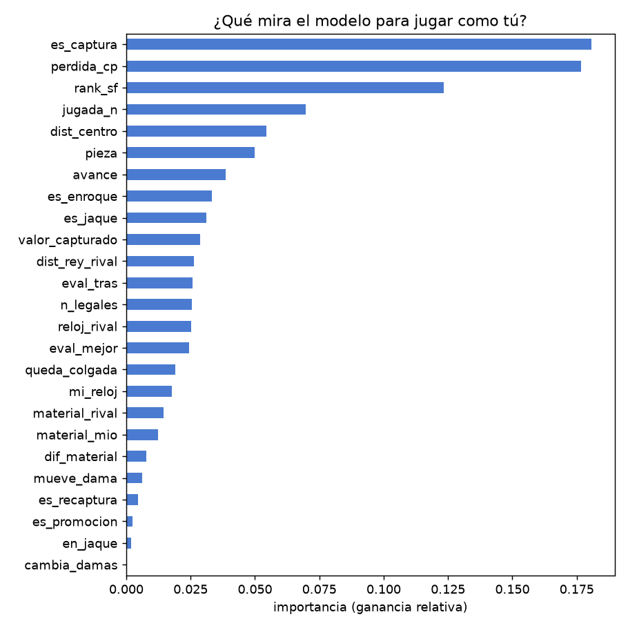

# ♟ Clon de Irvin: un bot de ajedrez que juega como yo

Proyecto de la materia de Inteligencia Artificial.

La idea es crear un bot que **imite mi forma de jugar** en chess.com, no uno que juegue perfecto.
📄 El informe académico completo está en **[INFORME.md](INFORME.md)**.

Lo entrené con **4,970 de mis partidas rapid** (10 minutos), de enero de 2024 a octubre de 2026.

## ¿Qué problema resuelve?

Los motores como Stockfish juegan muchísimo mejor que cualquier humano, así que jugar contra ellos no se parece a jugar contra una persona.
Las versiones "débiles" de los motores tampoco se parecen: cometen errores al azar, no los errores típicos de un jugador.

Este proyecto responde a dos preguntas:
- **¿Se puede aprender el estilo de un jugador a partir de sus partidas?** Con qué aperturas juega, qué tipo de jugadas prefiere y qué errores comete.
- **¿Qué tanto se parece el bot a mí?** Lo medimos con el porcentaje de posiciones en las que el bot elige **la misma jugada que yo hice** en partidas que nunca vio.

## Cómo funciona

```
Posición ──► ¿la he visto ≥3 veces en mis partidas? ──sí──► LIBRO: juego lo que yo suelo jugar (misma frecuencia)
                    │ no
                    ▼
         Stockfish propone 8 candidatas (búsqueda alfa-beta, profundidad 10)
                    │
                    ▼
         Para cada candidata se calculan 25 características
         (cuánto empeora vs. la mejor, si captura, si da jaque, qué pieza mueve, si deja una pieza colgada,
          cuánto reloj me queda, material, fase de la partida…)
                    │
                    ▼
         Modelo LightGBM (ranking LambdaRank) entrenado con mis partidas:
         le da a cada candidata un puntaje de "qué tanto se parece a lo que jugaría Irvin"
                    │
                    ▼
         Softmax sobre los puntajes ──► se elige la jugada (con algo de azar, como un humano)
```

### Relación con la Inteligencia Artificial

| Parte | Área de IA |
|---|---|
| Stockfish genera candidatas | **Búsqueda adversarial** (minimax con poda alfa-beta) y una función de evaluación con red neuronal (NNUE) |
| El modelo que elige "como yo" | **Machine Learning supervisado**: *learning to rank* con árboles de gradiente (LightGBM) |
| Libro de aperturas | Modelo estadístico de mis frecuencias, una forma simple de aprendizaje a partir de datos |
| El bot completo | Un **agente** que percibe el tablero y actúa eligiendo una jugada |

### ¿Cuál de los 4 enfoques de Russell y Norvig sigue?

**Actuar como humano.** El objetivo no es jugar de forma óptima, que sería *actuar racionalmente*: eso ya lo hace Stockfish.
El objetivo es que el comportamiento sea **indistinguible del mío**. Es la idea de la **prueba de Turing** aplicada al ajedrez: si alguien viera las partidas del bot, ¿podría distinguir si las jugué yo?
Por eso la métrica principal no es cuántas partidas gana, sino **cuántas veces coincide con mi jugada real**. Por eso también el bot **copia mis errores**: el modelo aprende cuánto suelo empeorar la posición, sobre todo cuando tengo poco tiempo en el reloj.

Internamente usa una pieza de *actuar racionalmente*: Stockfish propone jugadas razonables. Pero la decisión final la toma el modelo que imita al humano.

### ¿Por qué esta técnica?

- **¿Por qué no entrenar una red neuronal desde cero?** Con unas 130 mil posiciones no alcanza para que una red aprenda ajedrez sola: jugaría peor que yo, pero no *como* yo.
  Combinar un motor con un modelo que **elige entre sus candidatas** aprovecha que el motor ya "sabe jugar" y solo aprende *mis preferencias*.
- **¿Por qué ranking y no clasificación normal?** En cada posición hay que escoger 1 jugada de 8, así que es un problema de *ordenar* candidatas.
  LambdaRank optimiza justo eso: que la jugada que hice quede en primer lugar.
- **¿Por qué LightGBM?** Es rápido, funciona muy bien con datos tabulares y entrena en segundos en una laptop.
  Además dice **qué características pesan más**, lo cual ayuda a explicar el modelo (ver `modelo/importancia.png`).
- **¿Por qué separar por fecha?** Entreno con mis partidas viejas y evalúo con las **más recientes** (el último 15%).
  Así la prueba es honesta: el modelo predice partidas "del futuro" que nunca vio.

## Resultados

**Datos:**
- 4,970 partidas de 10 minutos con al menos una jugada mía, de enero de 2024 a octubre de 2026, que suman 131,145 posiciones mías.
- Se entrenó con 4,224 partidas y se evaluó con las **746 más recientes**, desde febrero de 2026, que suman 21,089 posiciones que el modelo nunca vio.

**¿En qué % de posiciones el bot elige exactamente la jugada que yo hice?**

| Método | Acierto |
|---|---|
| Elegir al azar entre las 8 candidatas | 12.6% |
| Stockfish (siempre su mejor jugada) | 32.0% |
| **Mi modelo** | **45.1%** |
| **Clon completo (libro + modelo)** | **45.7%** |
| Mi jugada está en el top 3 del modelo | 68.6% |
| Techo: mi jugada estaba entre las 8 candidatas de Stockfish | 81.1% |

El clon acierta **1.4 veces más que Stockfish** y **3.6 veces más que el azar**.
El techo es 81% porque en el 19% restante jugué algo que Stockfish ni siquiera considera entre sus 8 mejores: errores grandes o jugadas muy raras.

**Por fase de la partida:**

| Fase | Clon | Stockfish |
|---|---|---|
| Apertura (jugadas 1–10) | 51.0% | 25.0% |
| Medio juego (11–30) | 42.0% | 34.1% |
| Final (31+) | 45.2% | 38.0% |

La mayor diferencia está en la apertura: el libro y el modelo aprendieron mi repertorio, con 1.d4 con blancas y g6/d6 contra 1.e4 con negras.

**¿Comete errores como yo?** (`calibrar.py`, en centipeones perdidos por jugada contra la mejor de Stockfish)

| | Pérdida promedio |
|---|---|
| Yo, en mis partidas reales | 45.7 cp |
| Clon con temperatura 1.0 (valor por defecto) | 48.8 cp |
| Clon siempre eligiendo su favorita (temperatura 0) | 18.7 cp |
| Stockfish | 0 cp |

Con un poco de azar (softmax con temperatura 1), el clon se equivoca **casi lo mismo que yo**. Si siempre eligiera su favorita, jugaría "demasiado bien" para ser yo.

**¿Qué mira el modelo?** Las características más importantes son si la jugada **captura**, **cuánto empeora** la posición, el **lugar que le da Stockfish**, el **número de jugada**, la **distancia al centro**, **qué pieza** mueve, si **avanza** y si **enroca**.



## Cómo ejecutarlo

Requisitos: Python 3.10+ en Windows, Linux o Mac.

```bash
pip install -r requirements.txt
```

**1. Descargar Stockfish.** Bájalo de https://stockfishchess.org/download/ y descomprímelo dentro de la carpeta `motor/`.
El programa busca cualquier ejecutable llamado `stockfish*` ahí adentro. En Windows es `stockfish-windows-x86-64-*.exe`; en Linux o Mac quita el `.exe` del patrón en `construir_dataset.py` y `clon.py`.

**2. (Opcional) Volver a entrenar con las partidas de cualquier usuario de chess.com.** El modelo ya entrenado viene en `modelo/`.

```bash
python descargar_partidas.py irvinlozano rapid     # baja las partidas con la API pública de chess.com
python analizar_partidas.py irvinlozano rapid      # resumen: Elo, aperturas, resultados
python construir_dataset.py irvinlozano rapid      # Stockfish analiza cada jugada (~1-2 h con 18 núcleos)
python entrenar.py                                 # entrena y evalúa (genera modelo/ y métricas)
```

**3. Jugar contra el clon.**

```bash
python jugar.py
```

Se abre `http://localhost:8000`. Elige color y juega haciendo clic en la pieza y luego en la casilla.
El panel de la derecha muestra, en cada jugada del clon, si salió del **libro** o del **modelo**, y la probabilidad que el modelo le dio a cada candidata.

- `python jugar.py --temp 0`: el clon siempre juega su jugada favorita, sin azar.

## Archivos

| Archivo | Qué hace |
|---|---|
| `descargar_partidas.py` | Baja partidas de la API pública de chess.com y filtra por ritmo |
| `analizar_partidas.py` | Estadísticas: Elo por año, aperturas, resultados |
| `caracteristicas.py` | Las 25 características de cada jugada candidata |
| `construir_dataset.py` | Recorre mis partidas; Stockfish propone candidatas y marca la que jugué |
| `entrenar.py` | Entrena LightGBM LambdaRank, arma el libro y evalúa contra líneas base |
| `calibrar.py` | Busca la temperatura con la que el clon se equivoca igual que yo |
| `clon.py` | El agente: libro, candidatas de Stockfish y modelo |
| `jugar.py` + `web/index.html` | Interfaz web local para jugar contra el clon |
| `modelo/` | Modelo entrenado, libro de aperturas, métricas e importancia de características |
| `datos/` | Partidas descargadas (PGN) |
